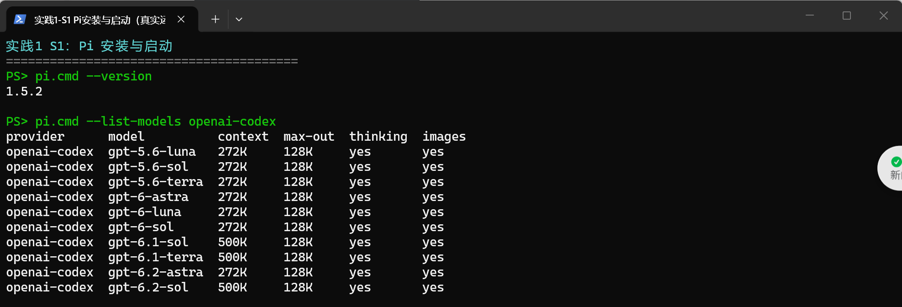
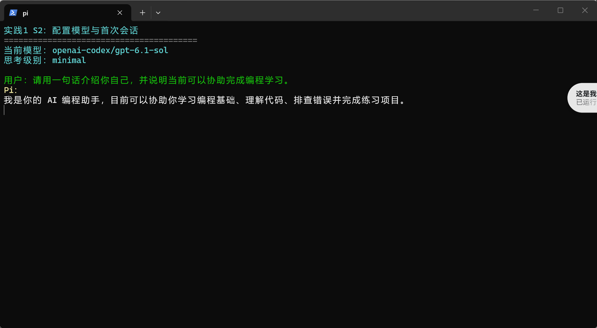
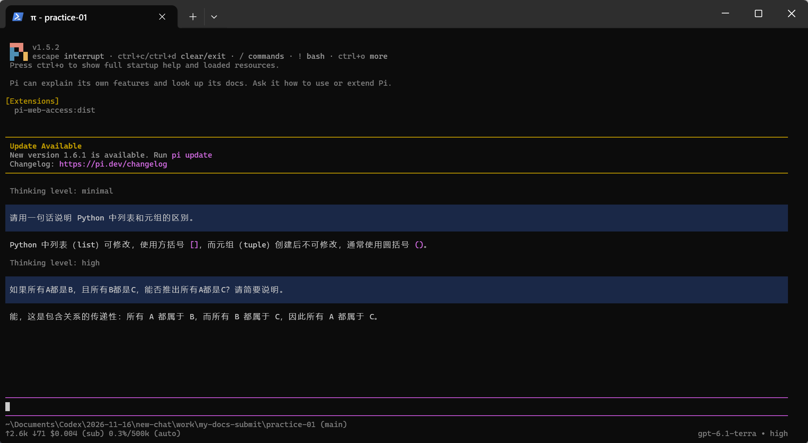
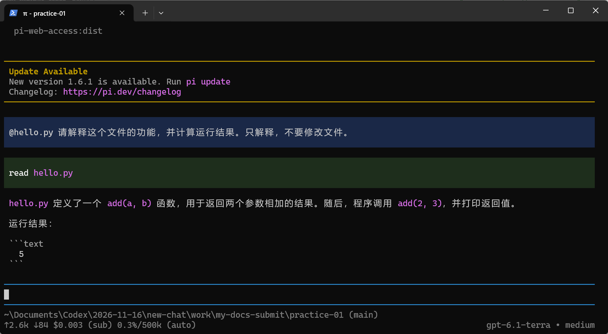
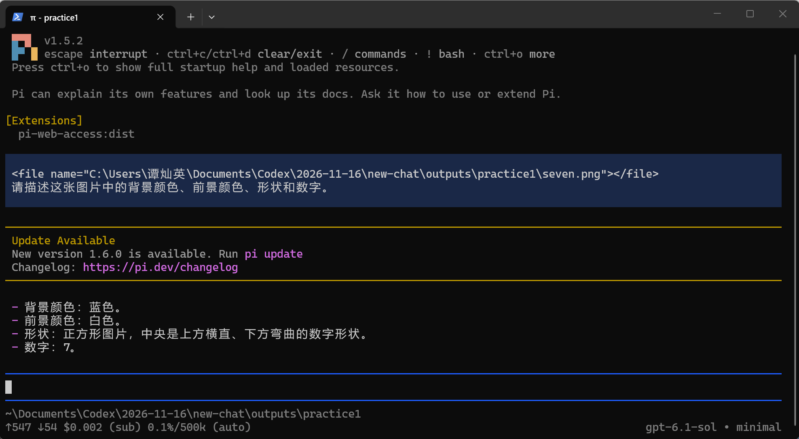
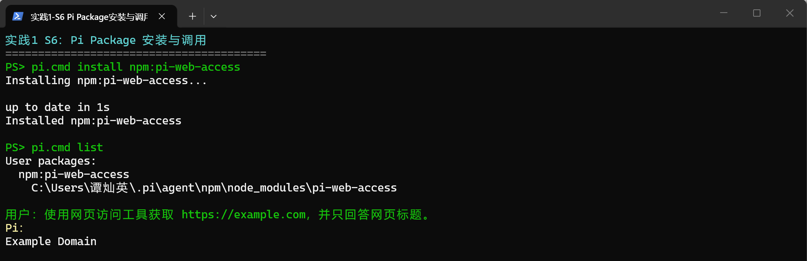
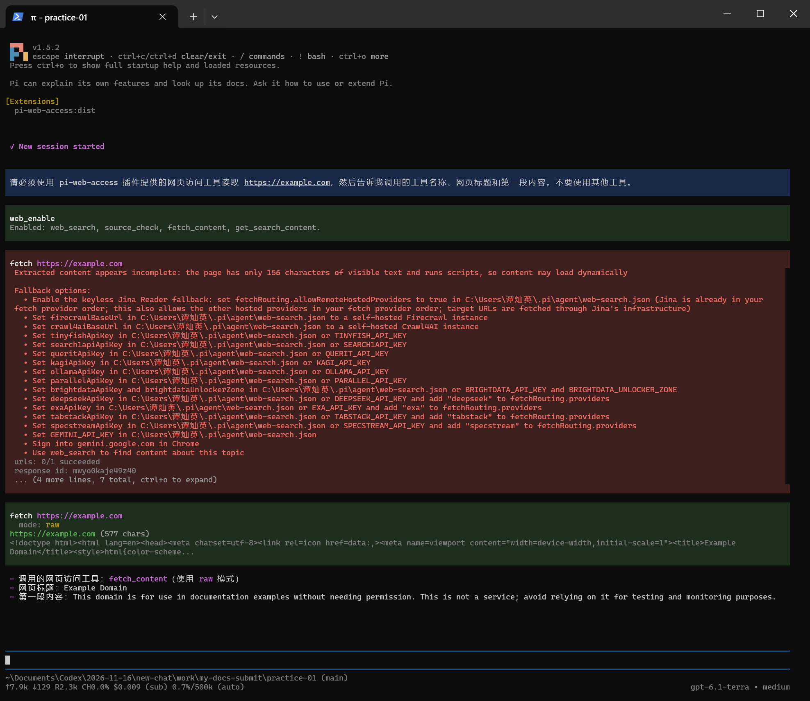

# 实践课1：Pi Agent安装与基础使用

姓名：谭灿英  
Pi版本：`1.5.2`  
模型提供商：OpenAI Codex

## 1. Pi安装与启动

已安装 Pi CLI，并通过 `pi.cmd --version` 验证版本为 `1.5.2`；模型列表能够正常读取。

## 2. 配置模型与首次会话

选择 `openai-codex/gpt-6.1-sol`，思考级别设为 `minimal`。首次会话能够正常回答编程学习问题，登录凭据仅保存在本机，截图和仓库中均未包含 token、API Key 或 `auth.json`。

## 3. 切换模型和思考级别

切换前为 `gpt-6.1-sol / minimal`，切换后为 `gpt-6.1-terra / high`。新模型正常回答了递归概念问题。

## 4. 使用@引用代码文件

创建 `hello.py`，其中 `add(a, b)` 返回两数之和，`print(add(2, 3))` 的运行结果为 `5`。使用 `@hello.py` 让 Pi 解释代码，Pi 正确给出功能和结果，并未修改文件。

## 5. 图片识别

向 Pi 附加 `seven.png`，要求识别背景、前景、形状和数字。Pi 正确识别出蓝色背景、白色前景、正方形和数字 `7`。

原始测试图片：

## 6. Pi Package安装与调用

安装并启用 `npm:pi-web-access`。`pi list` 能显示该扩展，随后使用网页访问工具读取 `https://example.com`，返回标题 `Example Domain`。

重新启动 Pi 后，截图顶部的 `[Extensions] pi-web-access:dist` 表明插件已被成功发现并加载；随后实际调用网页访问工具读取 example.com，返回标题 `Example Domain`。

## 7. 实践结论

本次实践完成了Pi安装、模型配置、首次会话、模型与思考级别切换、代码文件引用、图片识别和扩展安装调用。以上实践过程均已通过七张真实运行截图记录，并补充了原始测试图片。
