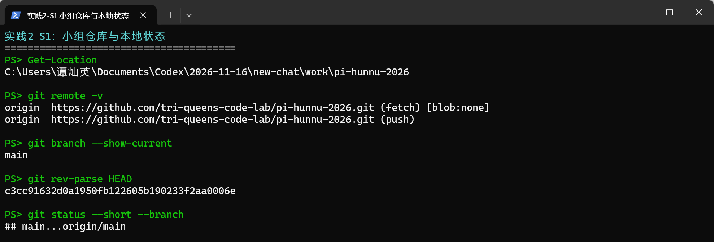
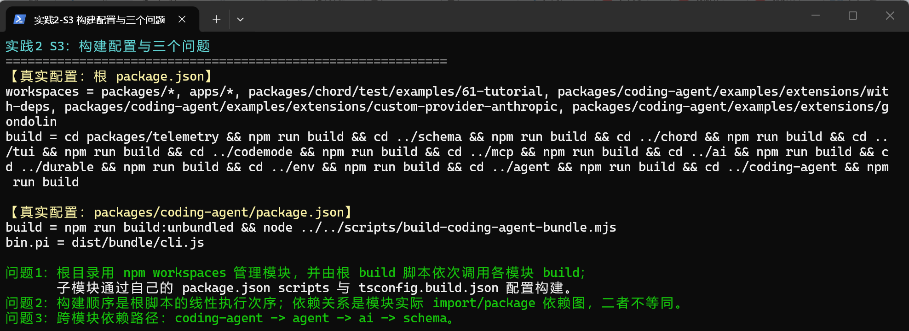
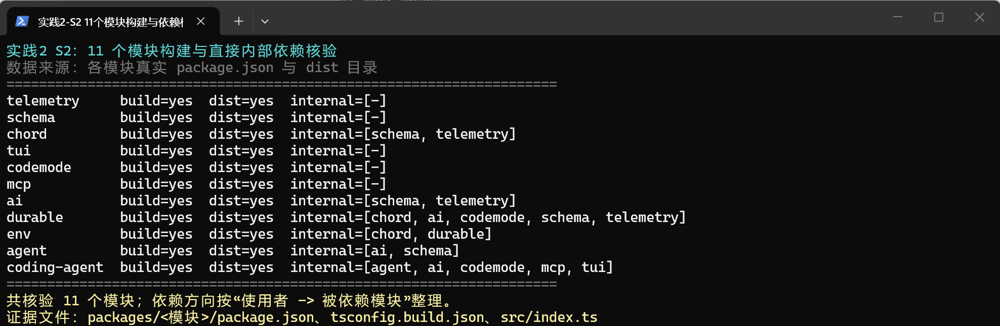
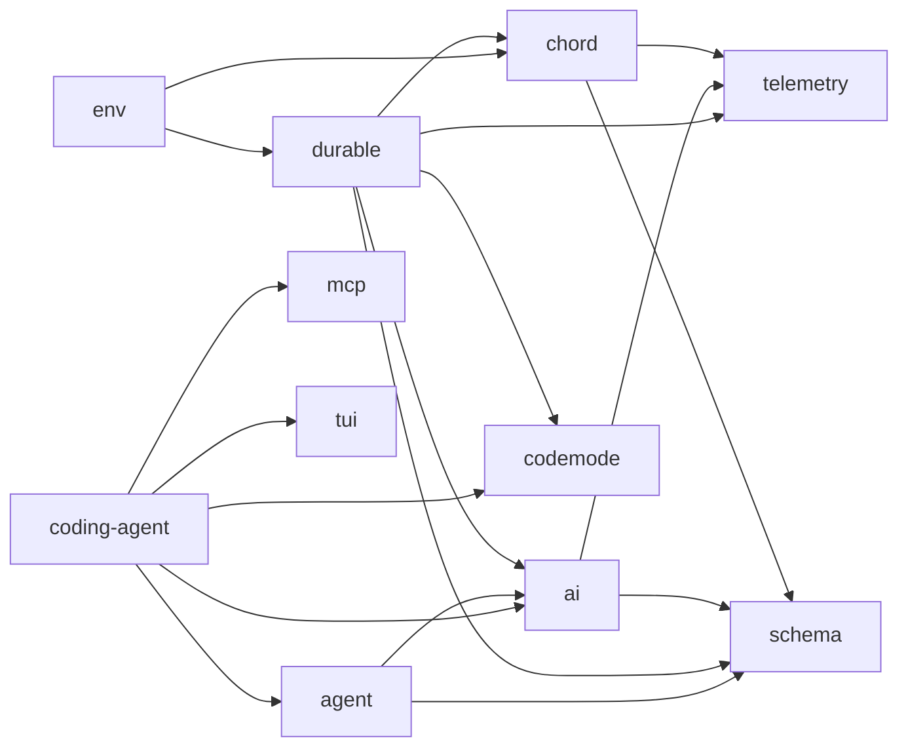
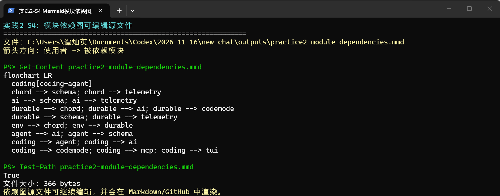

# 实践课2：组织建仓与源码分析

姓名：谭灿英  
小组组织：<https://github.com/tri-queens-code-lab>  
源码仓库：<https://github.com/tri-queens-code-lab/pi-hunnu-2026>  
分支：`main`  
HEAD：`c3cc91632d0a1950fb122605b190233f2aa0006e`

## 1. 仓库信息

```text
本地路径：C:\pi-hunnu-2026-main-evidence
remote：origin https://github.com/tri-queens-code-lab/pi-hunnu-2026.git
分支：main
HEAD：c3cc91632d0a1950fb122605b190233f2aa0006e
status：## main...origin/main
```

工作区无被跟踪文件修改，未使用GitHub的“Sync fork”。




该截图显示 GitHub 组织 `tri-queens-code-lab`、仓库 `pi-hunnu-2026`、`main` 分支和源码目录。


该截图同时显示本地源码路径、仓库根目录、`packages` 目录内容、`origin`、`main` 分支、完整 HEAD 以及工作区状态。

## 2. 根目录和子模块的构建配置

根目录 `package.json` 使用npm workspaces管理 `packages/*`、`apps/*` 和示例项目。根 `build` 脚本不是自动推导拓扑，而是通过 `&&` 依次进入11个模块执行各自的 `build`。

子模块在自己的 `package.json` 中定义构建脚本，通常通过 `tsc -p tsconfig.build.json` 将源码编译到 `dist`。其中：

- `ai` 先生成并校验模型数据，再编译和复制provider数据；
- `coding-agent` 先生成未打包产物和资源，再生成bundle；
- `env` 的Rust daemon由独立的 `build:daemon` 构建；
- `tui` 的平台原生组件由独立脚本构建。



## 3. 11个模块分析

本人重点分析的模块是 `coding-agent`。它是面向编码任务的交互式 CLI，位于依赖关系的上层，直接整合 `agent`、`ai`、`codemode`、`mcp` 和 `tui`，因此适合作为观察各模块协作方式的入口。

| 模块 | 主要功能 | 构建动作与主要产物 | 直接内部依赖 | 证据文件 |
|---|---|---|---|---|
| telemetry | 遥测契约、适配器、合规测试及类型化schema工具 | `tsc -p tsconfig.build.json`；生成 `dist` JS和声明文件 | 无 | `packages/telemetry/package.json`、`src/index.ts` |
| schema | 不依赖`eval`的JSON Schema校验器 | `tsc`；生成 `dist/index.js`、声明和formats导出 | 无 | `packages/schema/package.json`、`src/index.ts` |
| chord | 跨进程对象运行时，覆盖存储、链接、插件、HTTP、worker和客户端 | `tsc`；生成多入口JS和声明文件 | schema、telemetry | `packages/chord/package.json`、`src/index.ts` |
| tui | 采用差分渲染的终端UI库 | `tsc`生成 `dist`；原生组件由独立脚本处理 | 无 | `packages/tui/package.json`、`src/index.ts`、`native/` |
| codemode | 在受限JavaScript运行时中执行代码并调用注入工具 | `tsc`；生成主入口、worker等产物 | 无 | `packages/codemode/package.json`、`src/index.ts` |
| mcp | 独立Model Context Protocol客户端 | `tsc`；生成主入口、OAuth和testing产物 | 无 | `packages/mcp/package.json`、`src/index.ts` |
| ai | 统一多供应商LLM API、模型发现、流式调用及OAuth | 生成模型数据、校验、`tsc`并复制provider数据 | schema、telemetry | `packages/ai/package.json`、`catalog/generate.ts`、`src/index.ts` |
| durable | 持久化会话、任务和文档运行时 | `tsc`；生成主入口和多个子路径入口 | chord、ai、codemode、schema、telemetry | `packages/durable/package.json`、`src/index.ts` |
| env | 远程执行环境及SSH部署daemon | `tsc`生成 `dist`；Rust daemon由Cargo独立构建 | chord、durable | `packages/env/package.json`、`src/index.ts`、`daemon/Cargo.toml` |
| agent | 通用Agent运行时，提供工具调用、状态和附件支持 | `tsc`；生成 `dist/index.js` 和声明 | ai、schema | `packages/agent/package.json`、`src/index.ts` |
| coding-agent | 面向编码任务的交互式CLI，集成TUI、MCP、会话和扩展 | 未打包编译与资源复制后生成bundle；核心产物 `dist/bundle/cli.js` | agent、ai、codemode、mcp、tui | `packages/coding-agent/package.json`、`src/cli.ts`、`scripts/build-coding-agent-bundle.mjs` |

直接内部依赖取自各模块 `package.json` 中以 `@earendil-works/` 开头的 `dependencies`，不计开发依赖和传递依赖。



## 4. 模块依赖图

箭头方向统一为“使用者 → 被依赖模块”。可编辑源文件：[module-dependencies.mmd](module-dependencies.mmd)。

依赖图的层级依据各模块 `package.json` 中以 `@earendil-works/` 开头的直接 `dependencies` 划分：无内部依赖的模块作为基础层；只依赖基础层的模块置于其上；继续依赖这些模块的 `durable`、`env` 和 `coding-agent` 等逐层上移。开发依赖和传递依赖不参与层级划分。





## 5. 三个问题

### 5.1 根目录和子模块如何配置构建？

根目录负责工作区管理、统一路径配置和串行调度；子模块负责自己的编译细节、资源复制、导出入口和发布产物。根脚本进入模块目录调用其 `build`，子模块通常依据自己的 `tsconfig.build.json` 把源码写入 `dist`。

### 5.2 构建顺序和依赖关系有什么区别？

依赖关系描述模块实际使用关系，是有向图；构建顺序描述脚本执行先后，是线性序列。只要被依赖模块先于使用者完成，线性顺序就是有效的，但它可能包含不必要的串行约束。例如 `telemetry` 和 `schema` 均无内部依赖，理论上可以并行，根脚本仍固定先后构建。

### 5.3 一条至少跨3个模块的依赖路径

`coding-agent → agent → ai → schema`

该路径跨4个模块、3条直接依赖边。
