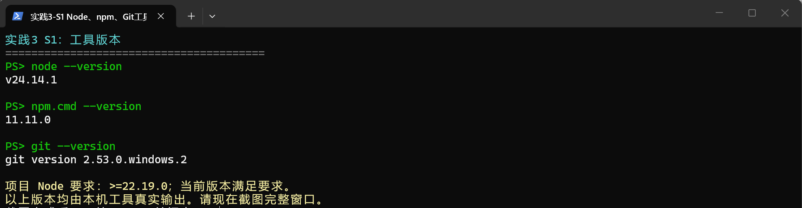
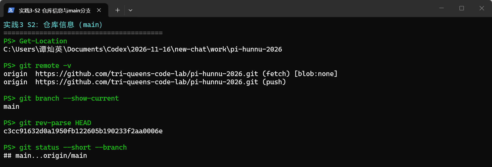
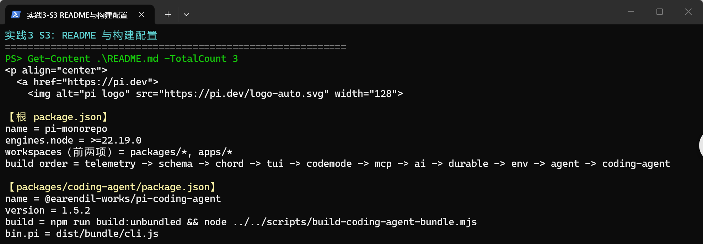
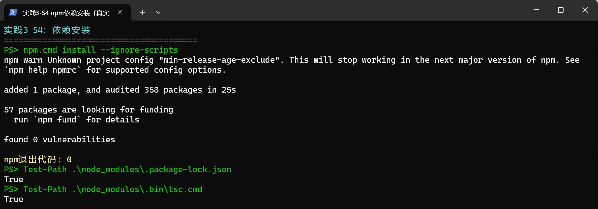
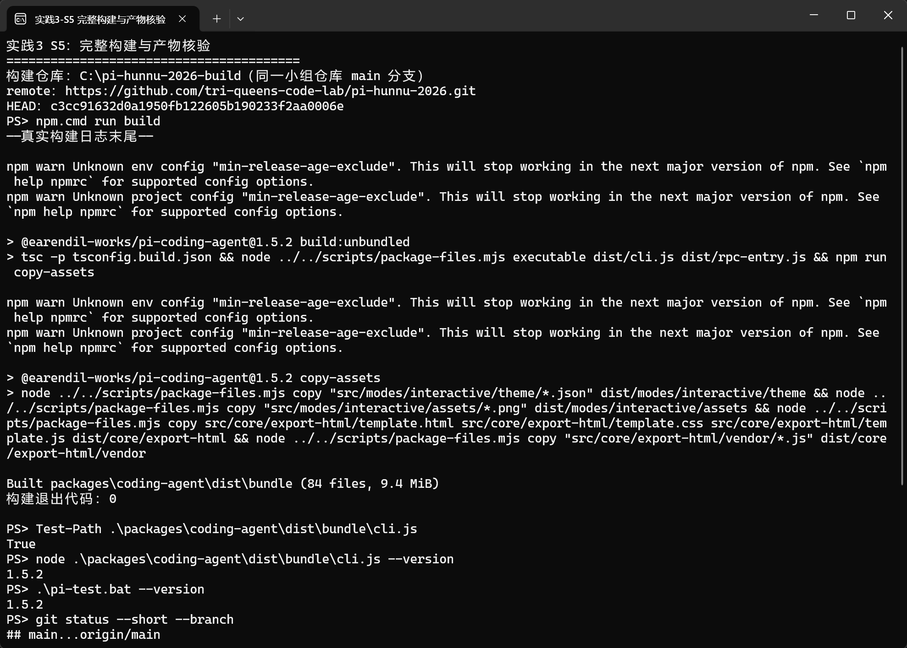
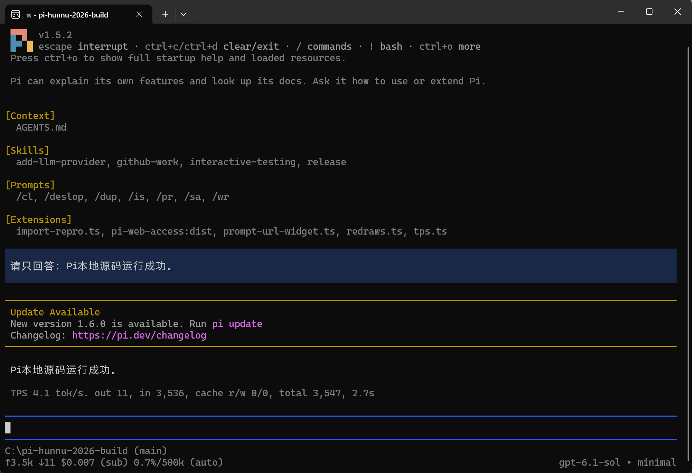

# 实践课3：Pi Agent源码安装与编译

姓名：谭灿英  
源码仓库：<https://github.com/tri-queens-code-lab/pi-hunnu-2026>  
分支：`main`  
HEAD：`c3cc91632d0a1950fb122605b190233f2aa0006e`

## S1 工具版本

```text
Node v24.14.1
npm 11.11.0
Git 2.53.0.windows.2
```

Node版本满足项目要求 `>=22.19.0`。



## S2 仓库信息

原始小组仓库位于：

```text
C:\Users\谭灿英\Documents\Codex\2026-11-16\new-chat\work\pi-hunnu-2026
origin https://github.com/tri-queens-code-lab/pi-hunnu-2026.git
main
c3cc91632d0a1950fb122605b190233f2aa0006e
## main...origin/main
```



## S3 构建配置

已阅读根 `README.md`、根 `package.json` 和 `packages/coding-agent/package.json`。根构建按以下顺序执行：

```text
telemetry → schema → chord → tui → codemode → mcp → ai → durable → env → agent → coding-agent
```

`coding-agent` 先执行未打包编译与资源复制，再运行 `build-coding-agent-bundle.mjs`。CLI入口为 `dist/bundle/cli.js`。



## S4 依赖安装

按指导书执行：

```powershell
npm.cmd install --ignore-scripts
```

npm退出代码为 `0`，安装后 `node_modules/.package-lock.json` 和 `node_modules/.bin/tsc.cmd` 均存在，审计结果为 `0 vulnerabilities`。



## S5 完整构建与产物核验

原始仓库路径含中文用户名，Node的 `fs.cpSync` 在Windows旧版命令链中复制provider数据时出现路径编码问题。为不修改小组源码，另在纯英文物理路径 `C:\pi-hunnu-2026-build` 克隆同一仓库 `main`；其remote和HEAD与原仓库完全一致。

在英文路径副本中执行：

```powershell
npm.cmd run build
```

构建结果：

```text
Built packages\coding-agent\dist\bundle (84 files, 9.4 MiB)
构建退出代码：0
Test-Path .\packages\coding-agent\dist\bundle\cli.js -> True
node .\packages\coding-agent\dist\bundle\cli.js --version -> 1.5.2
.\pi-test.bat --version -> 1.5.2
git status --short --branch -> ## main...origin/main
```
源码入口适合开发调试，可以直接观察模块加载过程并定位源码问题；`dist/bundle/cli.js` 是完整构建后生成的打包 CLI，适合验证编译产物能否独立启动、版本是否正确以及资源是否完整。



## S6 本地Pi交互

通过 `pi-test.bat` 从本地源码启动Pi v1.5.2，使用 `openai-codex/gpt-6.1-sol`、`minimal`思考级别发送简单问题。Pi正常返回“Pi本地源码运行成功。”，说明本地源码、登录状态和模型调用均正常。



## 困难与解决过程

首次在包含中文用户名的原始仓库路径中构建时，流程在复制 provider 数据阶段失败，问题出现在 Node 的 `fs.cpSync` 文件复制环节。检查 Node、npm 和依赖安装结果后，确认并非源码或依赖缺失导致。

为避免修改小组源码，我在纯英文物理路径 `C:\pi-hunnu-2026-build` 重新克隆同一仓库，并核对 `origin`、`main` 分支和 HEAD 均与原仓库一致。随后重新安装依赖并执行完整构建，最终退出代码为 `0`，`dist/bundle/cli.js` 和 `pi-test.bat` 均能正确输出版本 `1.5.2`。未单独保留失败界面截图，因此在报告中完整记录了故障现象、排查依据和解决方法。

## 实践结论

已完成工具版本核验、仓库信息记录、构建配置阅读、依赖安装、11个模块完整构建、CLI产物与版本核验，以及本地Pi正常交互。截图和仓库中未包含API Key、token或 `auth.json`。
