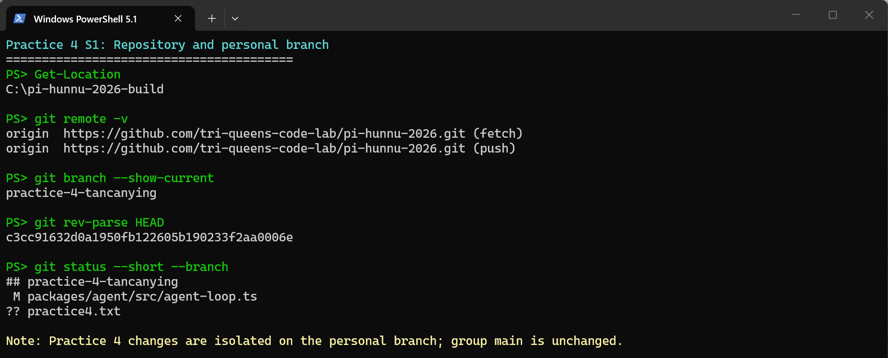
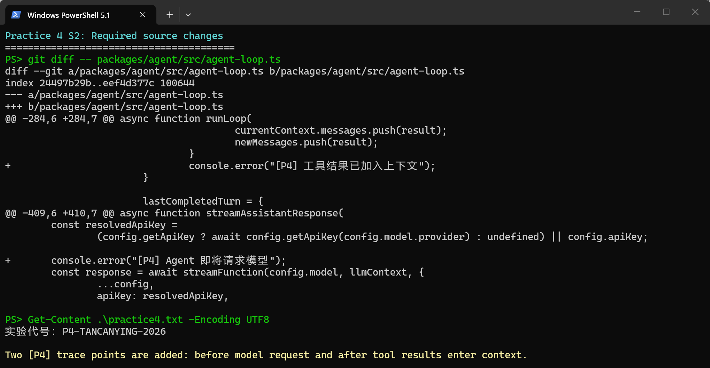
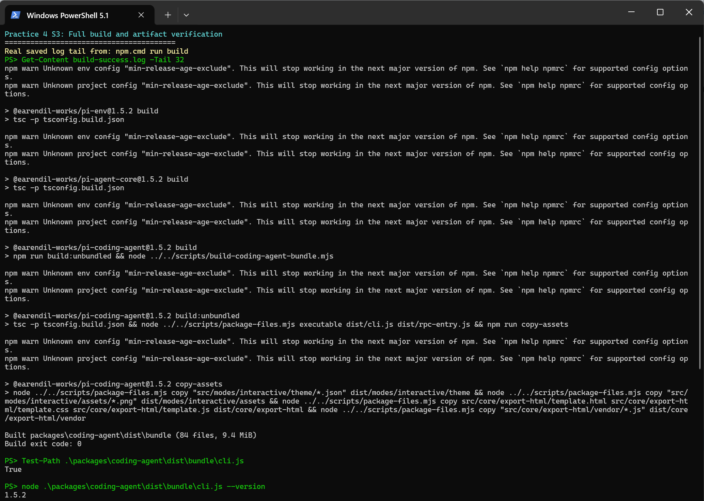
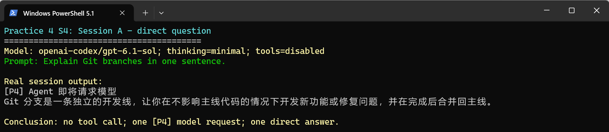
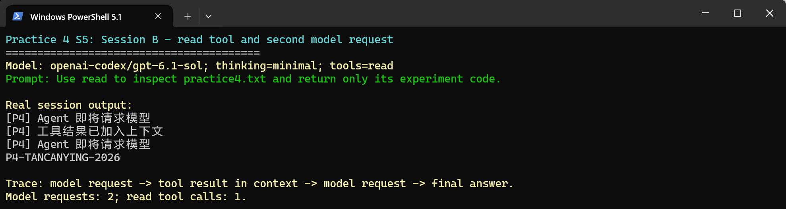
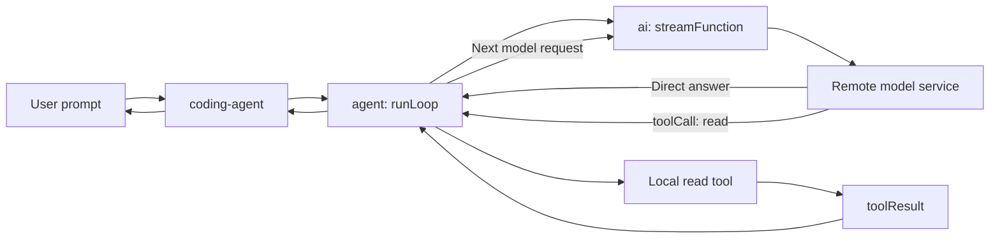
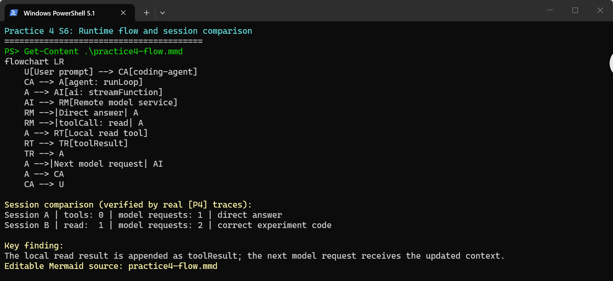

# 实践课4：Pi Agent模型调用与运行流程

姓名：谭灿英  
GitHub：`ttt587`  
小组源码仓库：<https://github.com/tri-queens-code-lab/pi-hunnu-2026>  
实践4源码分支：`practice-4-tancanying`  
实验基础提交：`c3cc91632d0a1950fb122605b190233f2aa0006e`

## 一、实践目标

本次实践通过在 Agent 循环中加入两处跟踪日志，对比“直接问答”和“调用本地工具读取文件”两种会话，理解模型请求、工具执行、工具结果写入上下文以及下一轮模型请求之间的关系。

## 二、仓库与分支

- 本地实验路径：`C:\pi-hunnu-2026-build`
- remote：`https://github.com/tri-queens-code-lab/pi-hunnu-2026.git`
- 实践分支：`practice-4-tancanying`
- 小组 `main` 分支未修改



## 三、源码修改

修改文件：`packages/agent/src/agent-loop.ts`。

### 1. 工具结果写入上下文后

在工具执行结果被加入 `currentContext.messages` 和 `newMessages` 后输出：

```ts
console.error("[P4] 工具结果已加入上下文");
```

### 2. 请求模型前

在调用 `streamFunction` 前输出：

```ts
console.error("[P4] Agent 即将请求模型");
```

实验文件 `practice4.txt` 的内容为：

```text
实验代号：P4-TANCANYING-2026
```



## 四、检查、构建与产物

源码修改后执行：

```powershell
npm.cmd run check
npm.cmd run build
```

最终结果：

- 完整代码检查通过。
- 11个模块完整构建成功，退出代码为 `0`。
- `coding-agent` bundle 共生成 `84 files, 9.4 MiB`。
- `packages/coding-agent/dist/bundle/cli.js` 存在。
- 本地源码 CLI 版本为 `1.5.2`。

构建期间模型目录服务曾短暂出现 DNS/连接重置，启用 Node 环境代理并重试后完整构建成功；未通过修改小组源码规避构建步骤。



## 五、会话A：直接问答

配置：

- 模型：`openai-codex/gpt-6.1-sol`
- thinking：`minimal`
- 工具：禁用
- 提问：用一句话解释 Git 分支是什么

真实日志和回答：

```text
[P4] Agent 即将请求模型
Git 分支是一条独立的开发线，让你在不影响主线代码的情况下开发新功能或修复问题，并在完成后合并回主线。
```

会话A没有工具调用，只请求模型一次，模型直接给出最终回答。



## 六、会话B：读取文件

配置与会话A保持相同，仅启用 `read` 工具，并要求 Pi 使用该工具读取 `practice4.txt` 后只回答实验代号。

真实日志和回答：

```text
[P4] Agent 即将请求模型
[P4] 工具结果已加入上下文
[P4] Agent 即将请求模型
P4-TANCANYING-2026
```

会话B的执行顺序为：

1. 第一次请求远程模型；
2. 模型返回 `read` 工具调用；
3. 本地工具读取文件，结果作为 `toolResult` 加入上下文；
4. 携带更新后的上下文第二次请求模型；
5. 模型根据工具结果给出正确实验代号。



## 七、会话对比

| 项目 | 会话A | 会话B |
|---|---:|---:|
| 工具调用次数 | 0 | 1（`read`） |
| 模型请求次数 | 1 | 2 |
| 工具结果写入上下文 | 否 | 是 |
| 最终结果 | 直接解释 Git 分支 | 正确返回文件实验代号 |

会话B比会话A多一次模型请求，原因是第一次模型请求只决定调用工具；本地工具执行完成后，Agent 将 `toolResult` 加入上下文，第二次模型请求才可以看到文件内容并生成最终回答。

## 八、运行流程图

箭头表示实际信息流和调用方向：



可编辑源文件：[practice4-flow.mmd](practice4-flow.mmd)。



## 九、结论

`coding-agent` 负责接收用户输入并展示结果；`agent` 维护循环、执行工具并更新上下文；`ai` 将规范化后的消息发送给远程模型服务。工具在本地执行，远程模型不会直接读取本机文件。只有当工具结果以 `toolResult` 进入上下文并发起下一轮模型请求后，模型才能利用该文件内容生成答案。

本报告及截图不包含 API Key、token、`auth.json` 或其他登录凭据。
