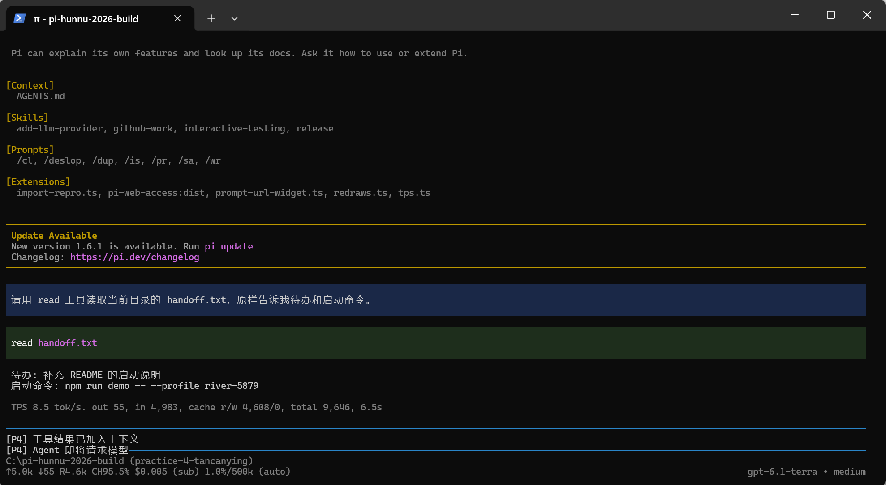
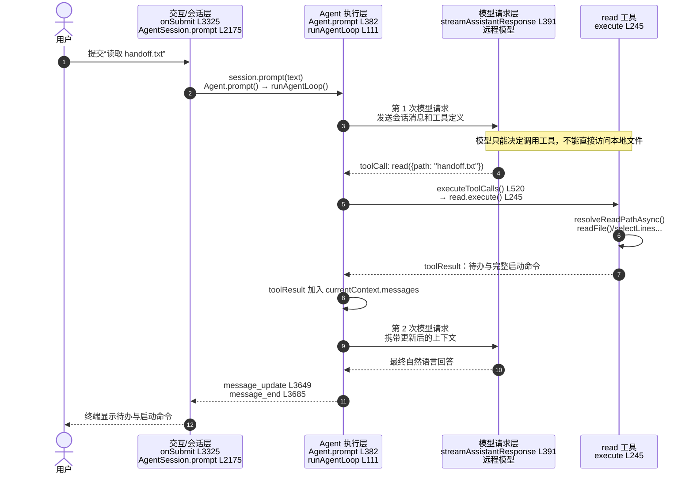
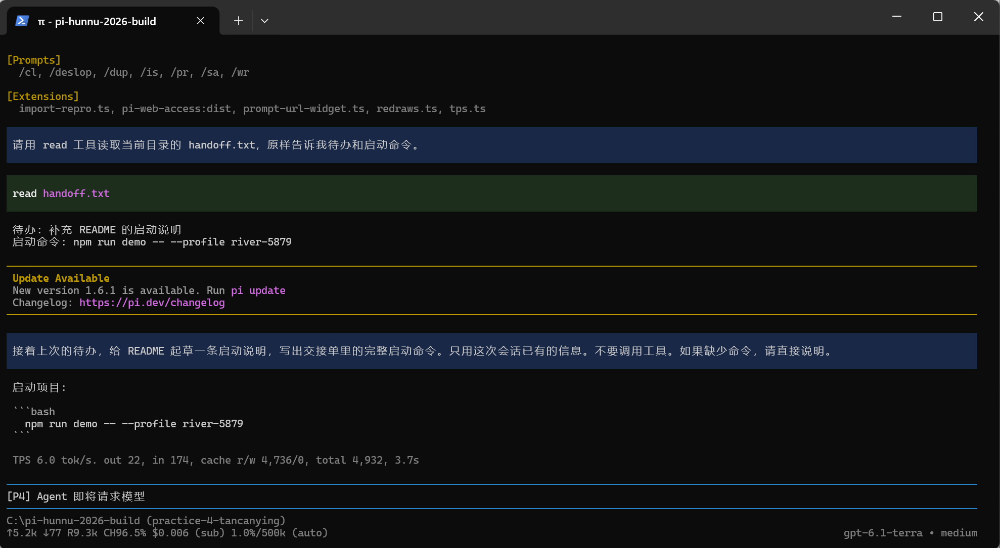
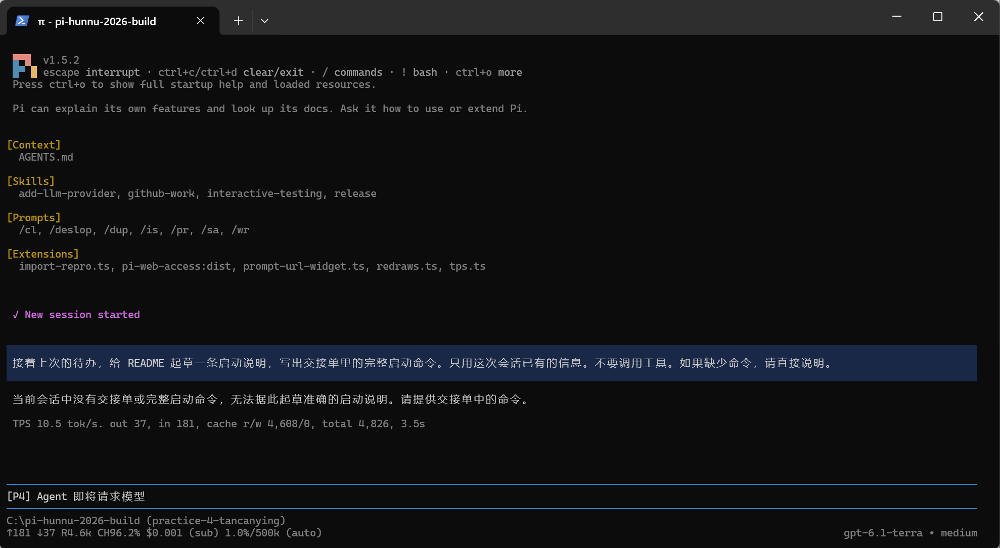
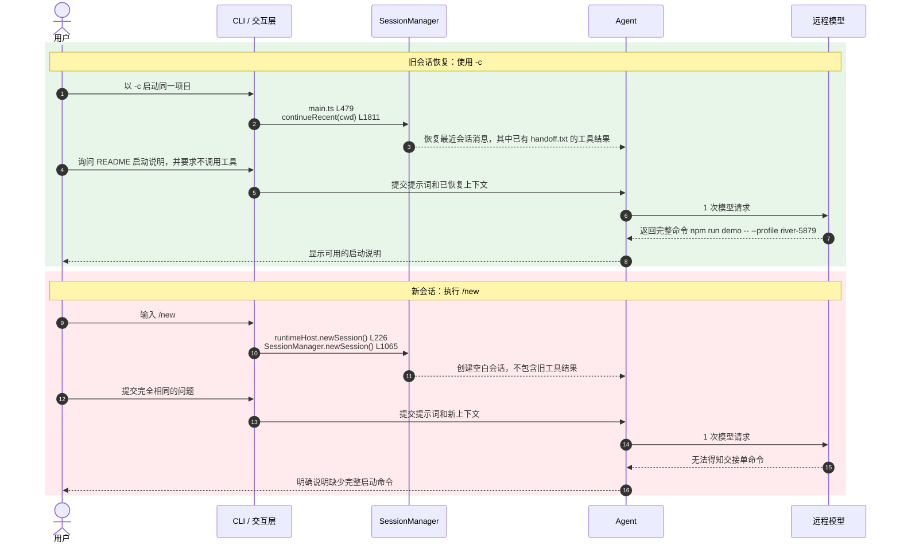

# 实践课5：Pi Agent 工具调用与会话恢复

姓名：谭灿英  
GitHub：`ttt587`  
小组源码仓库：<https://github.com/tri-queens-code-lab/pi-hunnu-2026>  
本地实验路径：`C:\pi-hunnu-2026-build`  
Pi 版本：`1.5.2`  
实验模型：`gpt-6.1-terra`，thinking 为 `medium`

## 一、实践目标

本次实践通过读取本地交接单、恢复旧会话和创建新会话，定位 Pi Agent 中用户输入、会话管理、Agent 循环、模型请求和本地 `read` 工具之间的调用关系，并验证工具结果进入会话上下文后是否能被后续会话继续使用。

## 二、实验交接单

在项目根目录创建 `handoff.txt`，内容为：

```text
待办：补充 README 的启动说明
启动命令：npm run demo -- --profile river-5879
```

启动本地构建产物：

```powershell
node .\packages\coding-agent\dist\bundle\cli.js
```

## 三、实验 A：调用 read 工具读取交接单

在新会话中输入：

```text
请用 read 工具读取当前目录的 handoff.txt，原样告诉我待办和启动命令。
```

Pi 先向模型发起请求，模型返回 `read handoff.txt` 工具调用。本地 `read` 工具读取文件后，工具结果被加入上下文，Agent 再次请求模型，最终准确返回：

```text
待办：补充 README 的启动说明
启动命令：npm run demo -- --profile river-5879
```



### 图 1：工具调用的代码级时序图



可编辑源文件：[fig1-tool-call-sequence.mmd](figures/fig1-tool-call-sequence.mmd)。

## 四、代码定位与职责分析

| 层级 | 关键文件与位置 | 作用 |
|---|---|---|
| 用户交互层 | `packages/coding-agent/src/modes/interactive/interactive-mode.ts`：`onSubmit`（L3325）、`subscribeToAgent()`（L3525）、`message_update`（L3649）、`message_end`（L3685） | 接收终端输入，订阅 Agent 事件并把回复显示给用户 |
| 会话层 | `packages/coding-agent/src/core/agent-session.ts`：`_startRun()`（L1956）、`prompt()`（L2175）、`_preparePrompt()`（L2215） | 准备提示词、维护会话状态并启动一次 Agent 运行 |
| Agent 执行层 | `packages/agent/src/agent.ts`：`prompt()`（L382）、`runPromptMessages()`（L441）；`packages/agent/src/agent-loop.ts`：`runAgentLoop()`（L111）、`executeToolCalls()`（L520） | 维护消息循环，判断并执行工具调用，将工具结果写回上下文 |
| 模型请求层 | `packages/agent/src/agent-loop.ts`：`streamAssistantResponse()`（L391）；`packages/ai/src/api/openai-codex-responses.ts`：`stream()`（L246） | 把上下文转换为模型消息并调用远程模型 |
| 本地工具层 | `packages/coding-agent/src/core/tools/read.ts`：`execute()`（L245）、`resolveReadPathAsync()`（L267） | 解析本地路径并读取文件，返回 `toolResult` |

本实验中的关键边界是：远程模型不直接读取 `handoff.txt`。它只返回 `toolCall`；文件访问发生在本机的 `read.execute()` 中。读取结果成为 `toolResult` 并进入 `currentContext.messages` 后，下一次模型请求才包含文件内容。

## 五、实验 B1：使用 `-c` 恢复旧会话

退出 Pi 后，在同一项目目录使用 `-c` 恢复最近会话：

```powershell
node .\packages\coding-agent\dist\bundle\cli.js -c
```

然后输入：

```text
接着上次的待办，给 README 起草一条启动说明，写出交接单里的完整启动命令。只用这次会话已有的信息。不要调用工具。如果缺少命令，请直接说明。
```

结果中没有新的工具调用，只有一次模型请求；模型仍能返回完整命令：

```text
启动项目：

npm run demo -- --profile river-5879
```

这说明 `-c` 通过 `SessionManager.continueRecent(cwd)` 恢复了最近会话，旧会话中的 `toolResult` 仍在上下文内。



## 六、实验 B2：使用 `/new` 创建新会话

在已恢复的会话中执行 `/new`，再输入与 B1 完全相同的问题。结果同样没有工具调用，只有一次模型请求，但模型明确回答当前会话没有交接单或完整启动命令，无法据此起草准确说明。

这说明 `/new` 创建了新的会话上下文，旧会话中的 `handoff.txt` 工具结果不会自动带入新会话。



### 图 2：旧会话恢复与新会话对比



可编辑源文件：[fig2-session-compare.mmd](figures/fig2-session-compare.mmd)。

## 七、实验结果对比

| 场景 | 上下文来源 | `read` 调用次数 | 模型请求次数 | 是否得到完整命令 |
|---|---|---:|---:|---|
| 会话 A：读取交接单 | 新会话 + 本地工具结果 | 1 | 2 | 是 |
| 会话 B1：`-c` 恢复 | 最近会话的历史消息 | 0 | 1 | 是 |
| 会话 B2：`/new` | 新建空白会话 | 0 | 1 | 否 |

会话 A 需要两次模型请求：第一次决定调用工具，第二次利用工具结果生成回答。B1 不需要重新读取文件，因为恢复后的历史上下文已经包含交接单内容。B2 虽然问题和 B1 完全相同，但新上下文没有旧工具结果，因此无法知道随机启动命令。

## 八、实践结论

Pi Agent 的工具调用是一个“模型决策—本地执行—结果回填—再次请求模型”的闭环。`read` 的文件访问发生在本机，模型只接收工具返回的内容。会话恢复和新建会话的核心差异不是当前目录是否相同，而是历史消息是否被重新载入：`-c` 恢复最近会话，所以先前工具结果可继续使用；`/new` 创建空白上下文，因此不会继承旧会话信息。

本报告与截图不包含 API Key、token、`auth.json` 或其他登录凭据。
