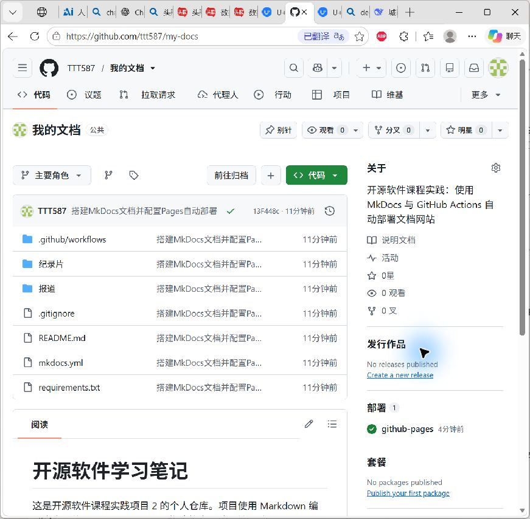
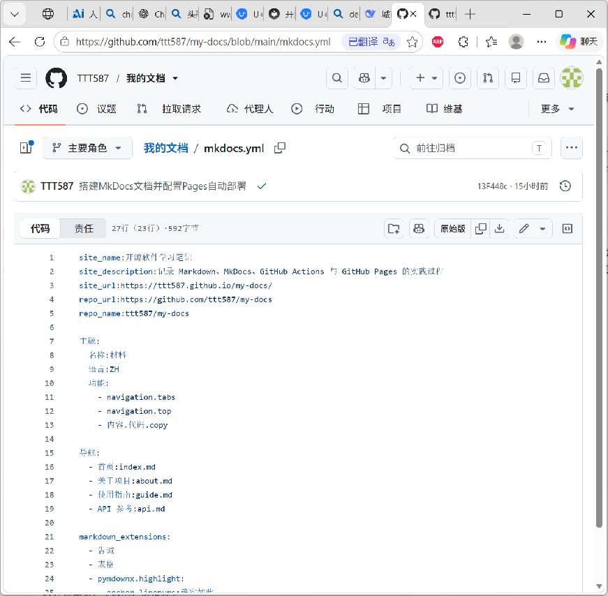
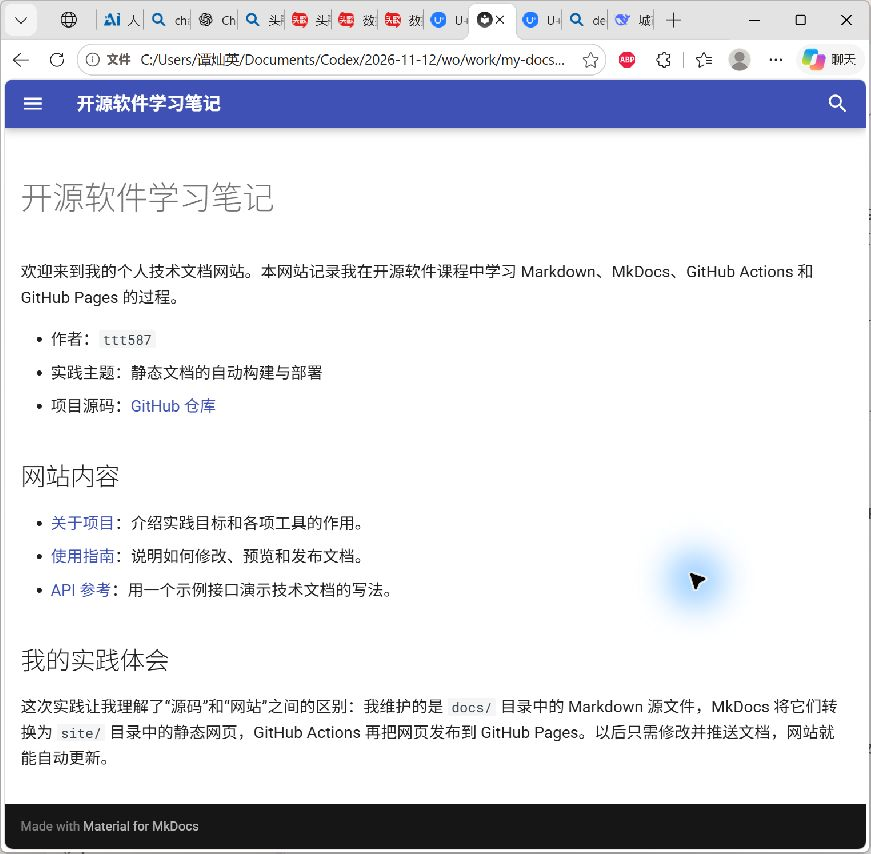
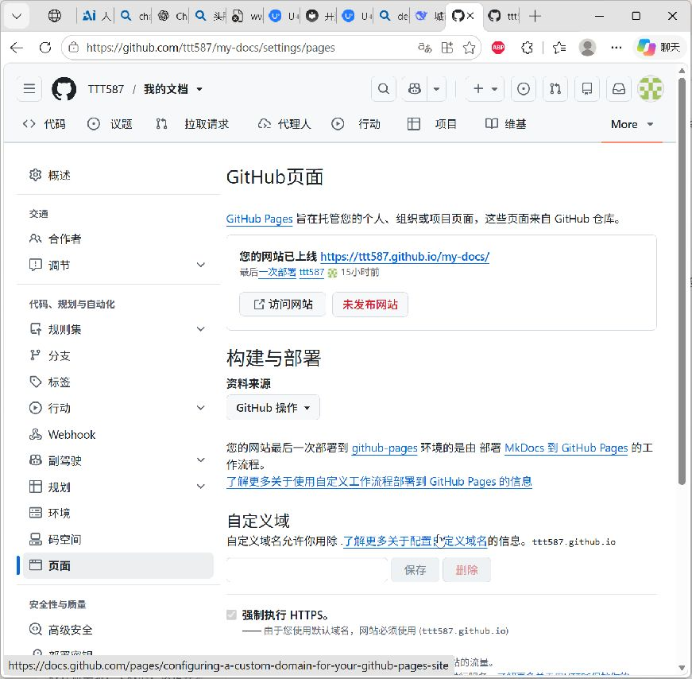
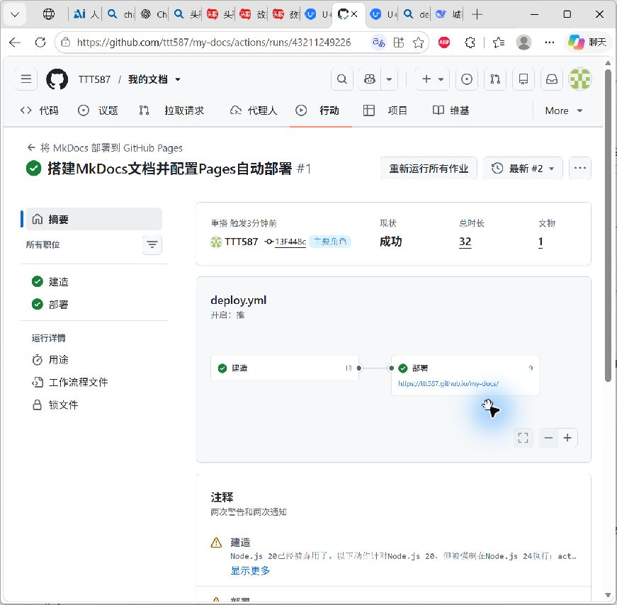
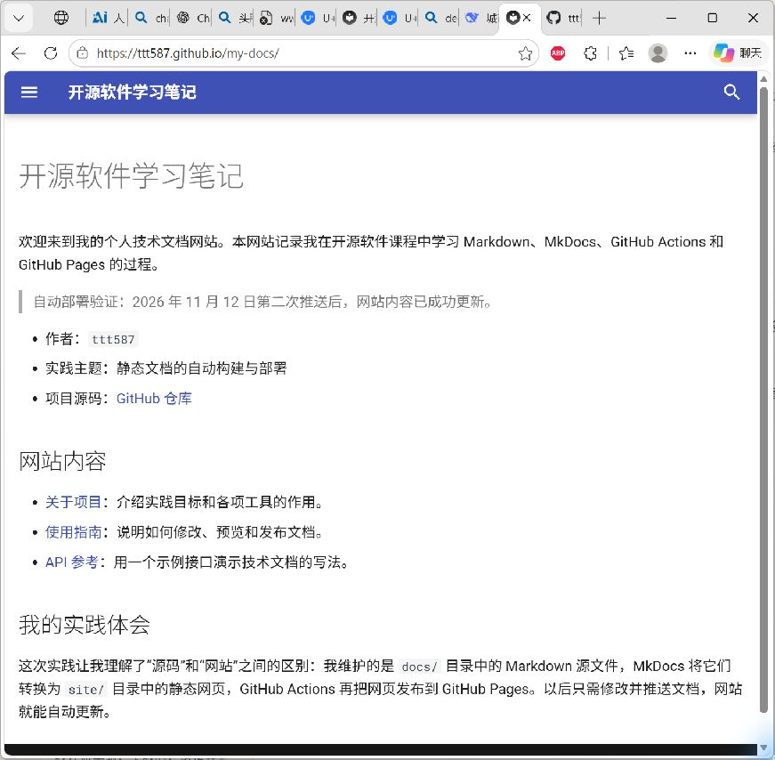
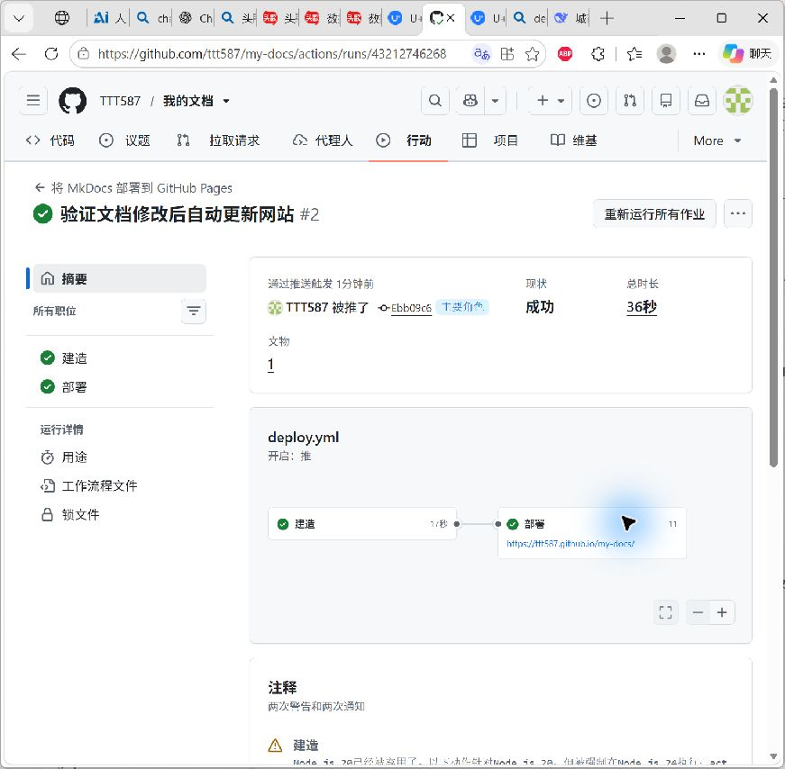

# 实践项目 2：个人实验报告

## 1. 基本信息

- 姓名：谭灿英
- GitHub 登录名：`ttt587`
- 个人仓库地址：<https://github.com/ttt587/my-docs>
- 最终网站地址：<https://ttt587.github.io/my-docs/>

## 2. 实践过程与关键截图

### 2.1 创建个人公开仓库

我使用本人 GitHub 账号创建了公开仓库 `my-docs`，默认分支为 `main`。公开仓库便于教师检查源码、提交历史和 Actions 运行记录。

### 2.2 项目结构与 MkDocs 配置

我在 `docs/` 中编写四个页面，并在 `mkdocs.yml` 的 `nav` 中配置导航。`docs/` 保存文档源文件，`nav` 决定网站菜单及页面顺序，`site/` 是 MkDocs 自动生成的构建产物。

### 2.3 本地构建和预览

我创建了 Python 虚拟环境，安装 `requirements.txt` 中的依赖，并执行 `python -m mkdocs build --strict`。严格构建成功后，我启动本地预览，逐页检查了导航、表格、代码块和页面链接。

### 2.4 配置 GitHub Pages

我在仓库设置中把 Pages 的发布来源设为 GitHub Actions，使官方 Pages 工作流能够部署构建产物。

### 2.5 首次自动构建和部署

推送源码后，工作流先执行 `build`，安装依赖并生成 `site/`；构建成功后，`deploy` 再把产物发布到 GitHub Pages。两个任务均成功完成。

### 2.6 检查公开网站

我打开了发布后的网站，并逐一检查首页、关于项目、使用指南和 API 参考四个页面，确认导航、样式、表格、代码块及页面链接均能正常显示。

### 2.7 第二次推送与自动更新验证

首次部署完成后，我在首页增加了一句容易识别的验证文字并再次推送。此次没有手动运行工作流，`push` 自动触发了新一次构建和部署；刷新网站后可以看到新增内容，说明自动更新链路有效。

- 对应提交链接：<https://github.com/ttt587/my-docs/commit/ebb09c66932b5818b9d430662299ca9b2ff377bf>
- 对应 Actions 运行链接：<https://github.com/ttt587/my-docs/actions/runs/43212746268>

## 3. 问题与解决

首次推送后，Actions 的第一次运行在 `actions/configure-pages` 步骤失败，日志显示无法取得 Pages 站点信息并返回 404。此时仓库虽然包含完整工作流，但仓库的 Pages 发布来源还没有启用，因此构建任务无法完成 Pages 配置。

我进入仓库的 **Settings → Pages**，把 **Source** 设置为 **GitHub Actions**，然后重新运行同一次工作流。第二次尝试中 `build` 和 `deploy` 均成功，网站发布到 <https://ttt587.github.io/my-docs/>。之后我修改首页并再次推送，新的 Actions 运行由 `push` 自动触发且一次成功，确认问题已经解决。

## 4. 原理理解

### 4.1 `docs/` 和 `site/` 各保存什么？为什么不用手工修改 `site/`？

`docs/` 保存人工编写的 Markdown 源文件，是需要长期维护和提交的内容。`site/` 保存 MkDocs 根据源码生成的 HTML、CSS、JavaScript 等静态文件。因为 `site/` 可以随时重新构建，手工修改会在下一次构建时被覆盖，所以应修改源文件而不是构建产物。

### 4.2 工作流在什么情况下自动运行？

当 `docs/**`、`mkdocs.yml`、`requirements.txt` 或 `.github/workflows/deploy.yml` 的改动被推送到 `main` 分支时，工作流自动运行。它也支持在 Actions 页面通过 `workflow_dispatch` 手动运行。

### 4.3 `build` 与 `deploy` 有什么区别？

`build` 负责检出源码、配置 Python、安装依赖、运行 MkDocs 并上传 `site/` 产物。`deploy` 依赖 `build` 的成功结果，负责把上传的产物发布到 GitHub Pages。前者生成可发布文件，后者让这些文件能够通过公网地址访问。

### 4.4 只修改 `report/README.md` 会触发部署吗？为什么？

不会。工作流的 `paths` 只包含网站源文档、MkDocs 配置、依赖文件和工作流文件，报告路径不在其中。这样可以避免只更新实验报告时重复部署网站。

### 4.5 为什么不需要创建 `gh-pages` 分支？

本项目使用 GitHub 官方 Pages Actions：工作流把 `site/` 上传为 Pages artifact，再由 `actions/deploy-pages` 直接部署。发布来源已经设置为 GitHub Actions，因此不需要用额外分支存放构建产物。

